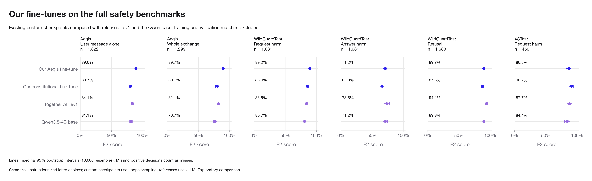

# Custom fine-tune benchmark

## Where fine-tuning helped

We fine-tuned Qwen3.5-4B in two ways: one model used 4,000 Aegis training examples, and the other used 4,000 synthetic examples generated from our safety constitution. Both used one epoch of LoRA training. We evaluated the saved checkpoints on the same benchmark items as the base model, after checking for overlap with their training and validation data.

The Aegis fine-tune showed the clearest improvements on request and exchange safety. On Aegis whole exchanges, F2 rose from 76.7% to 89.7%. It also scored higher on Aegis user messages and WildGuardTest requests, suggesting that the benefit extended beyond the dataset used for training.

| Task | Qwen3.5-4B base | Our Aegis fine-tune | Our constitutional fine-tune |
|---|---:|---:|---:|
| Aegis: User message alone | 81.1% | 89.0% | 80.7% |
| Aegis: Whole exchange | 76.7% | 89.7% | 80.1% |
| WildGuardTest: Request harm | 80.7% | 89.2% | 85.0% |
| WildGuardTest: Answer harm | 71.2% | 71.2% | 65.9% |
| WildGuardTest: Refusal | 89.8% | 89.7% | 87.5% |
| XSTest: Request harm | 84.4% | 86.5% | 90.7% |

Values are F2 scores, which give more weight to catching unsafe content (or refusals) than to avoiding false alarms.

The gains came with tradeoffs. On Aegis whole exchanges, the Aegis fine-tune reduced missed unsafe examples from 196 to 69, while increasing safe exchanges flagged as unsafe from 106 to 134. Its answer-safety F2 was essentially unchanged, and its refusal score did not improve. On XSTest, its F2 increased while overall accuracy fell, reflecting more false alarms.

The constitutional fine-tune showed a different pattern. Its highest observed F2 was on XSTest, where it scored 90.7%, compared with 84.4% for the base model. It also scored higher on WildGuardTest requests, but lower on answer safety and refusal detection.

These results support a task-specific benefit from fine-tuning. Training data can improve the decisions a model makes, but gains on request safety do not guarantee gains on answer safety or refusal detection. The custom checkpoints and base model used different serving implementations, so this is an exploratory comparison rather than a controlled estimate of the effect of fine-tuning alone.

## Evaluation details

Both existing custom Qwen3.5-4B LoRA checkpoints were evaluated without retraining.
Aegis and WildGuard use the revised source-specific instructions; XSTest uses the original request-harm instructions.
All training and validation exports were verified against their recorded training-time hashes.

| Model | Eligible items | Excluded items | Decisions |
|---|---:|---:|---:|
| Our Aegis fine-tune | 5,252 | 0 | 8,613 |
| Our constitutional fine-tune | 5,252 | 0 | 8,613 |

Braintrust experiments for Our Aegis fine-tune:
- [custom_finetune_full_20261019__safety_tev__interaction_harm__s2__aligned_long](https://www.braintrust.dev/app/eval_engineering/p/decision-interface-safety/experiments/custom_finetune_full_20261019__safety_tev__interaction_harm__s2__aligned_long)
- [custom_finetune_full_20261019__safety_tev__prompt_harm__s2__prompt_harm_s2](https://www.braintrust.dev/app/eval_engineering/p/decision-interface-safety/experiments/custom_finetune_full_20261019__safety_tev__prompt_harm__s2__prompt_harm_s2)
- [custom_finetune_full_20261019__safety_tev__prompt_harm__s2__aligned_long](https://www.braintrust.dev/app/eval_engineering/p/decision-interface-safety/experiments/custom_finetune_full_20261019__safety_tev__prompt_harm__s2__aligned_long)
- [custom_finetune_full_20261019__safety_tev__response_harm__s2__aligned_long](https://www.braintrust.dev/app/eval_engineering/p/decision-interface-safety/experiments/custom_finetune_full_20261019__safety_tev__response_harm__s2__aligned_long)
- [custom_finetune_full_20261019__safety_tev__response_refusal__s2__aligned_long](https://www.braintrust.dev/app/eval_engineering/p/decision-interface-safety/experiments/custom_finetune_full_20261019__safety_tev__response_refusal__s2__aligned_long)

Braintrust experiments for Our constitutional fine-tune:
- [custom_finetune_full_20261019__cc_repro__interaction_harm__s2__aligned_long](https://www.braintrust.dev/app/eval_engineering/p/decision-interface-safety/experiments/custom_finetune_full_20261019__cc_repro__interaction_harm__s2__aligned_long)
- [custom_finetune_full_20261019__cc_repro__prompt_harm__s2__prompt_harm_s2](https://www.braintrust.dev/app/eval_engineering/p/decision-interface-safety/experiments/custom_finetune_full_20261019__cc_repro__prompt_harm__s2__prompt_harm_s2)
- [custom_finetune_full_20261019__cc_repro__response_refusal__s2__aligned_long](https://www.braintrust.dev/app/eval_engineering/p/decision-interface-safety/experiments/custom_finetune_full_20261019__cc_repro__response_refusal__s2__aligned_long)
- [custom_finetune_full_20261019__cc_repro__prompt_harm__s2__aligned_long](https://www.braintrust.dev/app/eval_engineering/p/decision-interface-safety/experiments/custom_finetune_full_20261019__cc_repro__prompt_harm__s2__aligned_long)
- [custom_finetune_full_20261019__cc_repro__response_harm__s2__aligned_long](https://www.braintrust.dev/app/eval_engineering/p/decision-interface-safety/experiments/custom_finetune_full_20261019__cc_repro__response_harm__s2__aligned_long)

Exclusions use source IDs and normalized full-text/individual-turn matches. This is an exact/normalized overlap audit, not a semantic near-duplicate guarantee.

The chart uses the intersection of eligible item/task pairs across the custom models and matches released Tev1 and Qwen base predictions to those same pairs.
The full eligible metrics table preserves all eligible results for each custom model.

The custom checkpoints were trained before the current policy revision. Their results measure transfer to these instructions, including paired and refusal tasks.
Loops and vLLM use different serving implementations; do not interpret differences as a controlled causal estimate of fine-tuning alone.
F2 uses unsafe (or refusal) as the positive label. Accuracy counts every invalid output as incorrect. Marginal intervals do not establish pairwise significance.

| Model | Task cohort | n | Accuracy | F2 | No decision |
|---|---|---:|---:|---:|---:|
| Our constitutional fine-tune | aegis_conversation | 1,299 | 79.0% | 80.1% | 0 |
| Our constitutional fine-tune | aegis_single | 1,822 | 81.1% | 80.7% | 0 |
| Our constitutional fine-tune | wildguard_prompt | 1,681 | 83.6% | 85.0% | 0 |
| Our constitutional fine-tune | wildguard_refusal | 1,680 | 79.2% | 87.5% | 0 |
| Our constitutional fine-tune | wildguard_response | 1,681 | 65.4% | 65.9% | 0 |
| Our constitutional fine-tune | xstest_prompt | 450 | 91.3% | 90.7% | 0 |
| Qwen3.5-4B base | aegis_conversation | 1,299 | 76.8% | 76.7% | 0 |
| Qwen3.5-4B base | aegis_single | 1,822 | 78.2% | 81.1% | 0 |
| Qwen3.5-4B base | wildguard_prompt | 1,681 | 77.1% | 80.7% | 0 |
| Qwen3.5-4B base | wildguard_refusal | 1,680 | 91.0% | 89.8% | 0 |
| Qwen3.5-4B base | wildguard_response | 1,681 | 75.8% | 71.2% | 0 |
| Qwen3.5-4B base | xstest_prompt | 450 | 86.9% | 84.4% | 0 |
| Our Aegis fine-tune | aegis_conversation | 1,299 | 84.4% | 89.7% | 0 |
| Our Aegis fine-tune | aegis_single | 1,822 | 87.4% | 89.0% | 0 |
| Our Aegis fine-tune | wildguard_prompt | 1,681 | 84.4% | 89.2% | 0 |
| Our Aegis fine-tune | wildguard_refusal | 1,680 | 84.7% | 89.7% | 0 |
| Our Aegis fine-tune | wildguard_response | 1,681 | 71.0% | 71.2% | 0 |
| Our Aegis fine-tune | xstest_prompt | 450 | 81.3% | 86.5% | 0 |
| Together AI Tev1 | aegis_conversation | 1,299 | 82.0% | 82.1% | 0 |
| Together AI Tev1 | aegis_single | 1,822 | 86.1% | 84.1% | 1 |
| Together AI Tev1 | wildguard_prompt | 1,681 | 87.3% | 83.5% | 0 |
| Together AI Tev1 | wildguard_refusal | 1,680 | 93.5% | 94.1% | 0 |
| Together AI Tev1 | wildguard_response | 1,681 | 89.0% | 73.5% | 0 |
| Together AI Tev1 | xstest_prompt | 450 | 90.2% | 87.7% | 0 |
