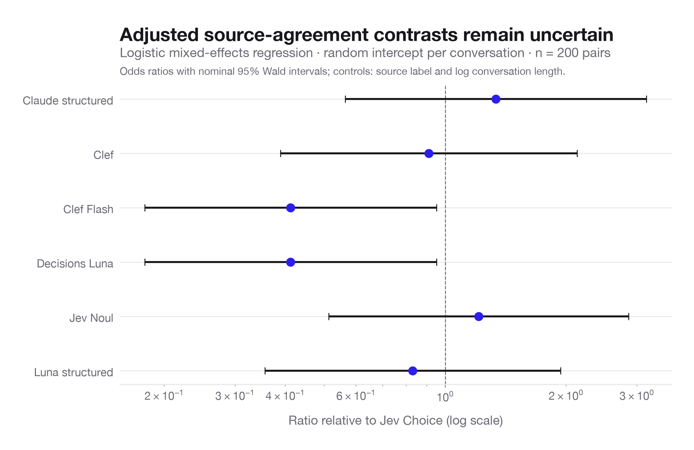
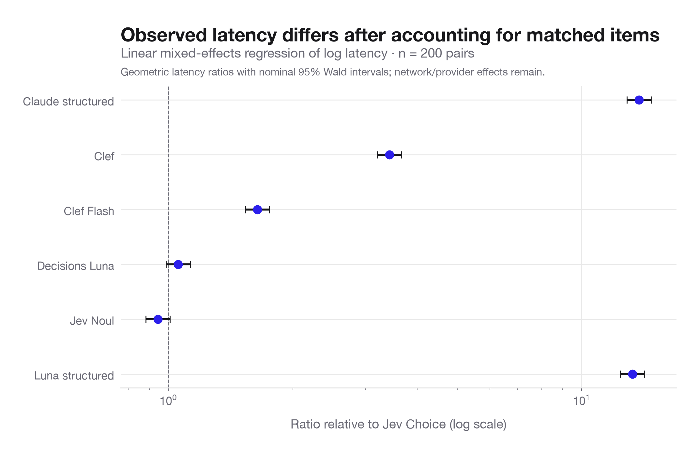

# Exploratory t-tests and mixed-effects regressions

Scope: 200 matched Aegis development pairs, seven arms, 1,400 reference interaction decisions. This is source-label agreement; no held-out or independent human-policy inference is made. All tests are post hoc and exploratory. Refusals count as incorrect rather than being removed.

## Paired agreement t-tests

Two-sided tests use each pair’s binary strict-correctness difference (df = 199); Holm correction covers all 21 arm comparisons. Nominal 95% t intervals and paired Cohen’s dz are exported. Exact McNemar tests provide a binary-outcome sensitivity check, corrected across their own 21-comparison family.

0/21 agreement t-tests and 0/21 exact McNemar tests remain below .05 after Holm correction. Failure to reject a difference is not evidence of equivalence.

| Comparison (A − B) | Difference (percentage points) | Nominal 95% CI | t | Raw p | Holm p |
|---|---:|---:|---:|---:|---:|
| Decisions Luna − Jev Noul | -6.00 | [-10.11, -1.89] | -2.880 | 0.004419 | 0.09279 |
| Clef Flash − Jev Noul | -6.00 | [-10.34, -1.66] | -2.726 | 0.006981 | 0.1396 |
| Jev Choice − Decisions Luna | 5.00 | [0.87, 9.13] | 2.384 | 0.01804 | 0.3428 |
| Claude structured − Clef Flash | 6.50 | [1.07, 11.93] | 2.361 | 0.01917 | 0.3451 |
| Claude structured − Decisions Luna | 6.50 | [1.07, 11.93] | 2.361 | 0.01917 | 0.3451 |
| Jev Choice − Clef Flash | 5.00 | [0.21, 9.79] | 2.058 | 0.04092 | 0.6548 |
| Clef − Decisions Luna | 4.50 | [-0.40, 9.40] | 1.810 | 0.07177 | 1 |
| Clef − Clef Flash | 4.50 | [-0.79, 9.79] | 1.679 | 0.09475 | 1 |
| Decisions Luna − Luna structured | -4.00 | [-9.01, 1.01] | -1.575 | 0.1169 | 1 |
| Clef Flash − Luna structured | -4.00 | [-9.56, 1.56] | -1.418 | 0.1578 | 1 |
| Claude structured − Luna structured | 2.50 | [-2.43, 7.43] | 1.000 | 0.3185 | 1 |
| Jev Choice − Jev Noul | -1.00 | [-2.97, 0.97] | -1.000 | 0.3185 | 1 |
| Jev Noul − Luna structured | 2.00 | [-2.63, 6.63] | 0.852 | 0.3951 | 1 |
| Claude structured − Clef | 2.00 | [-3.22, 7.22] | 0.755 | 0.4511 | 1 |
| Clef − Jev Noul | -1.50 | [-5.57, 2.57] | -0.727 | 0.4682 | 1 |
| Jev Choice − Claude structured | -1.50 | [-6.44, 3.44] | -0.599 | 0.5498 | 1 |
| Jev Choice − Luna structured | 1.00 | [-3.19, 5.19] | 0.470 | 0.6385 | 1 |
| Jev Choice − Clef | 0.50 | [-3.33, 4.33] | 0.258 | 0.797 | 1 |
| Clef − Luna structured | 0.50 | [-4.24, 5.24] | 0.208 | 0.8354 | 1 |
| Claude structured − Jev Noul | 0.50 | [-4.64, 5.64] | 0.192 | 0.8479 | 1 |
| Clef Flash − Decisions Luna | 0.00 | [-3.95, 3.95] | 0.000 | 1 | 1 |

## Logistic mixed-effects regression

`correct ~ arm + source_unsafe + centered_log_chars + (1 | item_id)`

The random conversation intercept accounts for repeated judgments of each item. Jev Choice is the reference arm. The normal random-intercept likelihood is integrated with fixed Gauss-Hermite quadrature and optimized by maximum likelihood; Wald intervals come from the full observed-information matrix. Six model-versus-baseline coefficient p-values receive Holm correction.

Omnibus arm likelihood-ratio test: χ²(6) = 15.203, p = 0.01874. Item random-intercept SD = 4.675.

The exploratory arm × source-label model improves fit by χ²(6) = 53.105, p = 1.117e-09. Its full coefficients are exported; this is a separate nominal omnibus test.

| Arm vs Jev Choice | Odds ratio | Nominal 95% CI | Holm p |
|---|---:|---:|---:|
| Claude structured | 1.337 | [0.564, 3.169] | 1 |
| Clef | 0.910 | [0.389, 2.129] | 1 |
| Clef Flash | 0.413 | [0.179, 0.951] | 0.2263 |
| Decisions Luna | 0.413 | [0.179, 0.951] | 0.2263 |
| Jev Noul | 1.212 | [0.513, 2.861] | 1 |
| Luna structured | 0.830 | [0.356, 1.936] | 1 |

## Log-latency mixed-effects regression

`log(latency_seconds) ~ arm + source_unsafe + centered_log_chars + (1 | item_id)`

Fit by maximum likelihood, optimizer `lbfgs`, converged = True. Omnibus arm Wald test: χ²(6) = 14437.211, p < 0.001. Ratios compare geometric latencies, not arithmetic means or medians. End-to-end timings include provider/network effects.

Separate paired t-tests on matched log latency find 18/21 comparisons below .05 after their own Holm adjustment.

## Checks and limits

Analytical GLMM gradient versus independent finite differences: maximum absolute error 7.21e-09. All logistic fits converged, had positive observed-information eigenvalues, and met quadrature tolerances across successive node grids (up to 641 nodes). Primary maximum coefficient drift: 1.35e-06.

The balanced sample is development data and is not an independent replication. The mixed models assume independent conversation clusters and a normal random intercept. They do not include model random effects (these seven arms are the fixed comparisons of interest), dataset random effects (only one source), or reviewer random effects (no audit labels). An arm-specific item random-slope structure is not attempted with one reference observation per arm/item. No claims of equivalence or causal architecture effects follow from these tests.

Independent Powell optimizer check: maximum fixed-effect drift 1.19e-13; log-likelihood drift 2.58e-08.

Latency fit warnings (including earlier unsuccessful optimizer attempts): Random effects covariance is singular; The MLE may be on the boundary of the parameter space..

Recreate: `.venv/bin/python -m analysis.inferential_models`. CSVs include full pairwise tests, regression data, and coefficients; `summary.json` records formulas, convergence, random-effect variance, input hash, and numerical checks.

Method references: [SciPy paired t-test](https://docs.scipy.org/doc/scipy/reference/generated/scipy.stats.ttest_rel.html), [Gaussian quadrature nodes](https://docs.scipy.org/doc/scipy/reference/generated/scipy.special.roots_hermitenorm.html), [statsmodels linear mixed models](https://www.statsmodels.org/stable/mixed_linear.html).
