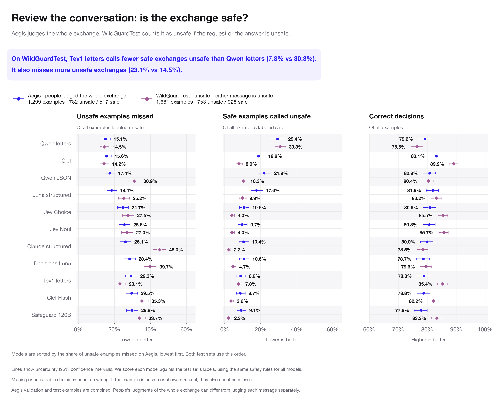
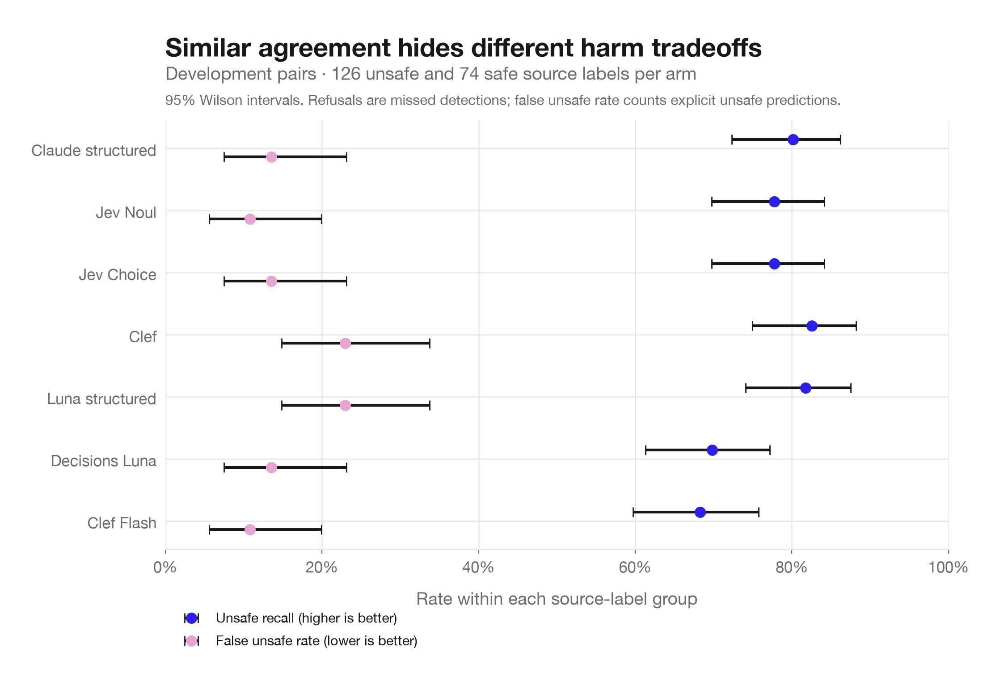
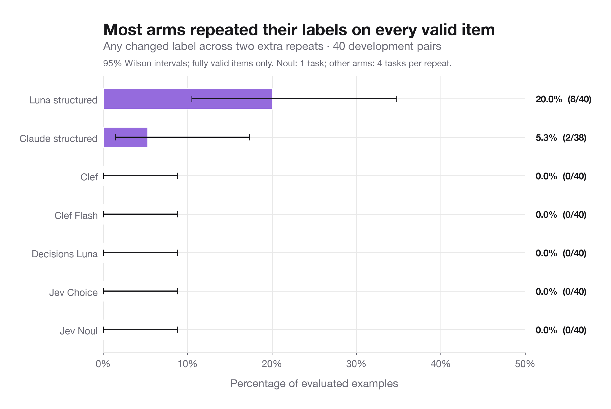
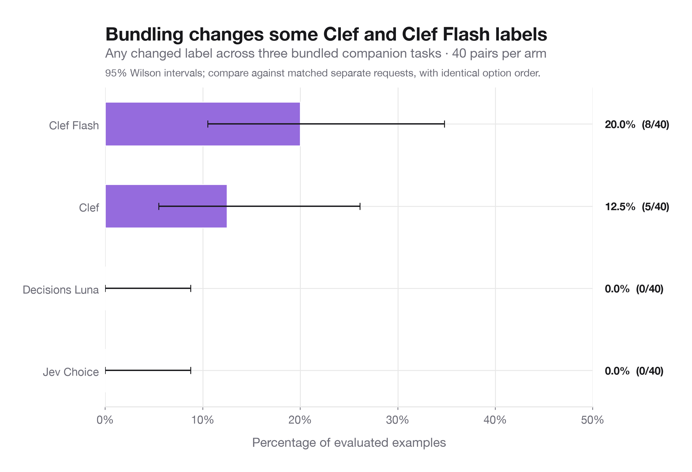
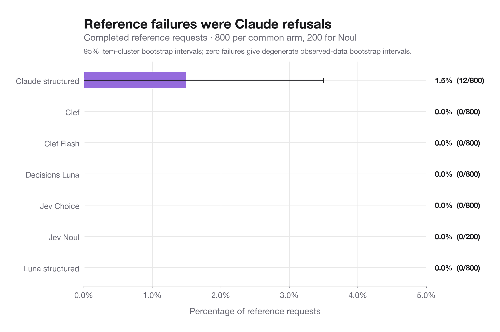
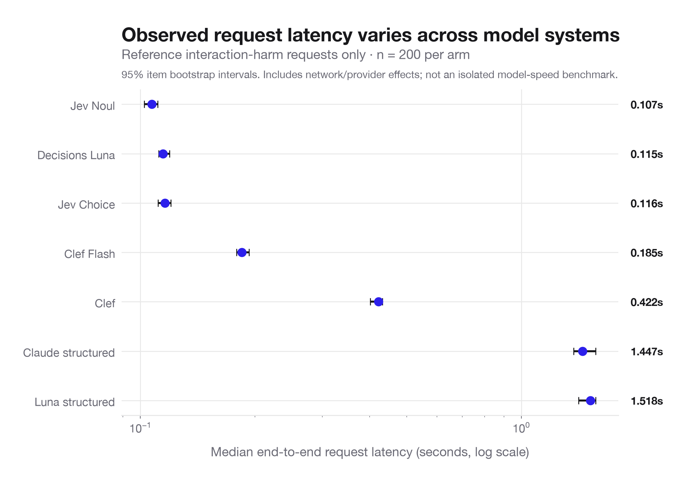

# Development analysis — 2026-10-07

The completed development runs support technical and exploratory comparisons. The main reference sample contains 200 Aegis V2 validation conversation pairs (126 unsafe, 74 safe); every hosted arm classified the same pairs with the binary long rubric. This is source-label agreement, not independently reviewed study-policy accuracy or held-out generalization. The stratified sample and descriptive intervals do not establish population prevalence.

| Model | Strict source agreement | Macro F1 | Unsafe recall | False unsafe rate |
|---|---:|---:|---:|---:|
| Claude structured | 82.5% | 0.826 | 80.2% | 13.5% |
| Jev Noul | 82.0% | 0.815 | 77.8% | 10.8% |
| Jev Choice | 81.0% | 0.804 | 77.8% | 13.5% |
| Clef | 80.5% | 0.794 | 82.5% | 23.0% |
| Luna structured | 80.0% | 0.789 | 81.7% | 23.0% |
| Decisions Luna | 76.0% | 0.756 | 69.8% | 13.5% |
| Clef Flash | 76.0% | 0.758 | 68.3% | 10.8% |

The chart below uses the completed tests to check safety across whole exchanges. For Aegis, the test answer is the majority of people’s safety votes. For WildGuardTest, we count an exchange as unsafe if either the request or the answer was labeled unsafe. We combined the Aegis groups called “validation” and “test,” counting each example once; their separate results are still available. Checking requests, checking answers, and checking whether the assistant refused each have their own charts in the [guide to choosing a model for safety checks](../safety-usecases-2026-10-14/report.html). That guide explains what each test can tell us and what each model gets wrong. Rebuild with `.venv/bin/python -m analysis.plot_source_agreement`. The table above uses 200 development examples; the other charts and numbers on this page also keep their original development scope.

[Separate request-screening plot](../safety-usecases-2026-10-14/01_request_screening.png) · [Assistant-answer safety plot](../safety-usecases-2026-10-14/02_response_safety.png) · [Refusal detection](../safety-usecases-2026-10-14/04_refusal_detection.png)

The observed agreement range is 76–82.5%. Avoid a definitive winner claim from this development sample. The paired-difference table resamples matching items within safe/unsafe strata (5,000 draws, fixed seed). Its 21 pairwise intervals are exploratory, nominal 95% intervals with no multiple-comparison adjustment. Overlap of individual model intervals is not itself a paired significance test.

## Repeatability and batching

| Model | Repeat label changes / valid comparisons | Items with any repeat change | Items excluded for failed outputs |
|---|---:|---:|---:|
| Luna structured | 11/320 | 8/40 | 0 |
| Claude structured | 2/304 | 2/38 | 2 |
| Clef | 0/320 | 0/40 | 0 |
| Clef Flash | 0/320 | 0/40 | 0 |
| Decisions Luna | 0/320 | 0/40 | 0 |
| Jev Choice | 0/320 | 0/40 | 0 |
| Jev Noul | 0/80 | 0/40 | 0 |

Repeatability uses two extra calls per task on 40 reference pairs. Items with any failed reference/repeat output are excluded from the any-change chart and counted separately. Noul has one task; other arms have four, so the item-level chance of a change is not directly comparable across those task counts. Zero observed changes do not establish universal determinism.

| Model | Batched label changes / comparisons | Items with any batching change |
|---|---:|---:|
| Clef Flash | 9/120 | 8/40 |
| Clef | 5/120 | 5/40 |
| Decisions Luna | 0/120 | 0/40 |
| Jev Choice | 0/120 | 0/40 |

All 160 batched calls produced 480 valid decisions. Batching changed 5/120 Clef decisions and 9/120 Clef Flash decisions, versus 0/120 for Jev Choice and Decisions Luna. The companion tasks do not have independent human gold in this Aegis development sample; changes measure disagreement between request forms, not improvement or degradation in accuracy. Retain separate requests for the primary matched comparison.

## Reliability and latency

The reference run completed 5,000 calls: 4,988 valid outputs and 12 Claude refusals. Repeatability completed 2,000 calls: 1,984 valid outputs and 16 Claude refusals. Neither stage had API errors. The earlier schema check contains three invalid Jev distributions and five Decisions refusals; those failures are retained separately rather than hidden in a binary reference aggregate.

Latency is the observed end-to-end adapter timing for reference interaction requests, including provider/network and any retries. It is not isolated inference throughput; these arms have different providers and interfaces. Failure intervals resample entire items to preserve correlation across tasks. Bootstrap intervals for zero observed failures are degenerate; they are not a guarantee of zero future failure risk.

## PolicyLM supplement and remaining limits

PolicyLM returned valid outputs for 208/208 User-only inputs. It matched prompt source labels on 7/8 reserved WildGuard pairs. The tiny source-exposed subset is not a reliable generalization comparison and is excluded from primary model rankings. The other 200 User predictions have no independent human prompt gold.

Baseten models have no successful new preflight in this stage; Safeguard readiness timed out and all six deployments were shut down. No Baseten performance ranking is inferred. The audit is configured for one reviewer, but actual judgments are still pending. Human agreement statistics remain unmeasured. Exact dollar comparisons are omitted because Decisions rates, provider fees, and compute billing are unresolved.

Recreate with `.venv/bin/python -m analysis.make_development_charts`. `decisions.csv` contains tidy decision-level records without raw conversation/span payloads. `summary.json` includes input hashes, counts, and methods. Each chart is exported as PNG and SVG.
