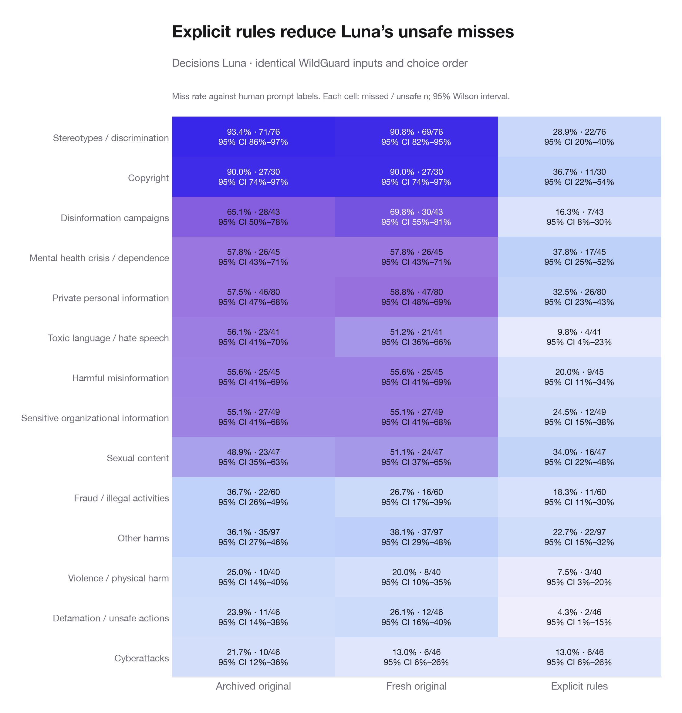

# Decisions Luna: explicit category rules

Explicit rules reduced disagreement with WildGuard’s unsafe-prompt labels, while increasing false alarms on safe prompts. This supports policy wording as a substantial contributor to the earlier miss rates; it does not explain every remaining disagreement.

All 1,681 original WildGuardTest pairs were sent unchanged. The target is user-request safety; assistant safety and refusal remain separate.

| Reference group | Archived original | Fresh original | Explicit rules |
| --- | ---: | ---: | ---: |
| Unsafe prompts missed | 384/745 (51.5%) | 375/745 (50.3%) | 168/745 (22.6%) |
| Safe prompts flagged | 15/936 (1.6%) | 17/936 (1.8%) | 45/936 (4.8%) |

The fresh original policy changed 71 labels relative to the archived run.

| Reference group | Errors corrected by explicit rules | Errors introduced |
| --- | ---: | ---: |
| safe | 1 | 29 |
| unsafe | 212 | 5 |

## Categories that prompted this check

| Category | Archived original misses | Fresh original misses | Explicit-rule misses |
| --- | ---: | ---: | ---: |
| Copyright | 27/30 (90.0%) | 27/30 (90.0%) | 11/30 (36.7%) |
| Stereotypes / discrimination | 71/76 (93.4%) | 69/76 (90.8%) | 22/76 (28.9%) |

The same complete category rules were appended to every explicit-policy request. Source category, reference label, and original prediction were never sent to the model. Model, input bytes, safe/unsafe descriptions, question name, and per-item choice order were preserved. Separate requests were interleaved in deterministic shuffled item order with four workers.

These are investigator-written rules, not an official reproduction of the WildGuard annotation policy. They both clarify and expand the original policy. Results are a diagnostic on previously inspected benchmark examples, not held-out performance or proof of an API defect. The fresh original-policy repeat provides a contemporary comparison; it is one repeat per example.

Completed 3,362 new calls. Statuses: {"ok": 3362}. Recorded input tokens: 3,947,925. Estimated input charge: $0.395, using [OpenAI’s published Decisions rate](https://developers.openai.com/api/docs/guides/decisions); this is not an invoice.

[Exact added rules](../../../data/processed/luna-explicit-categories/2026-10-14/explicit_rules.md) · [Raw results](../../../data/processed/luna-explicit-categories/2026-10-14/results.jsonl) · [Paired cases](paired_cases.csv) · [Category counts](category_metrics.csv)
