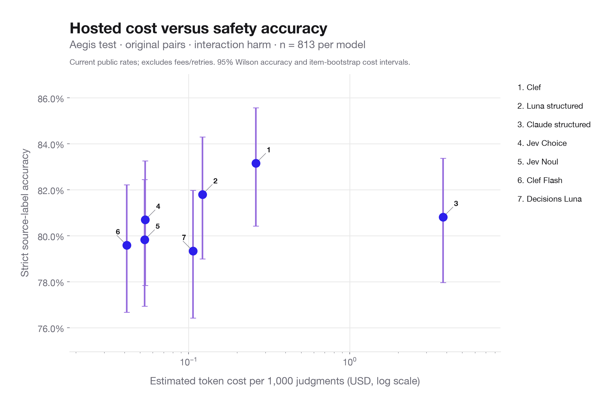
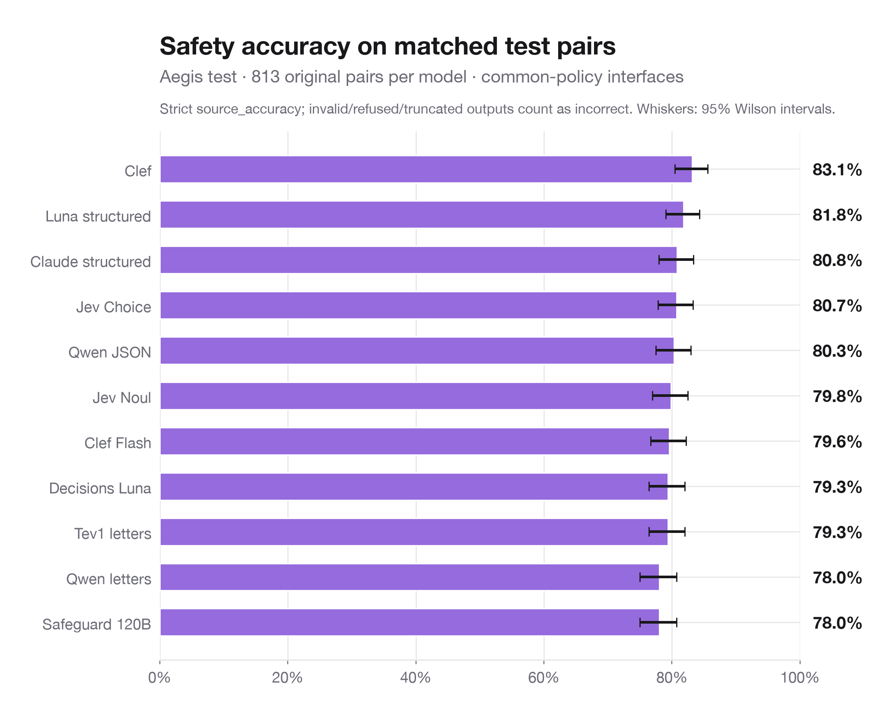
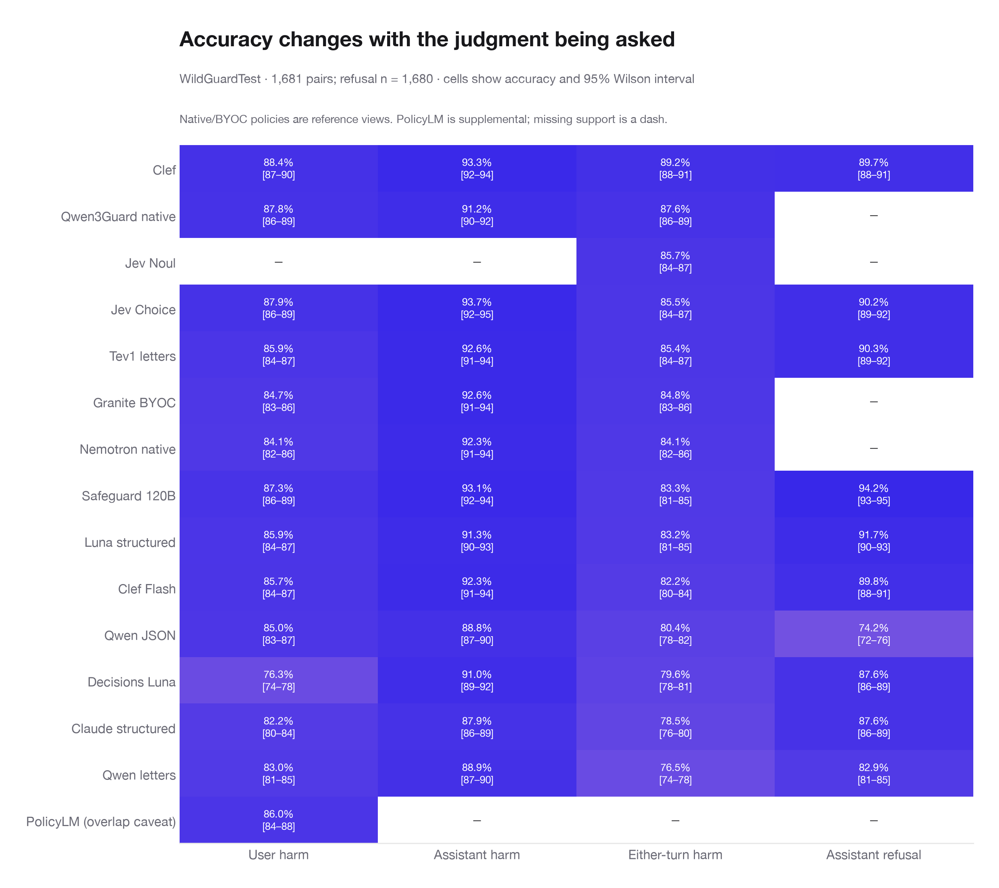
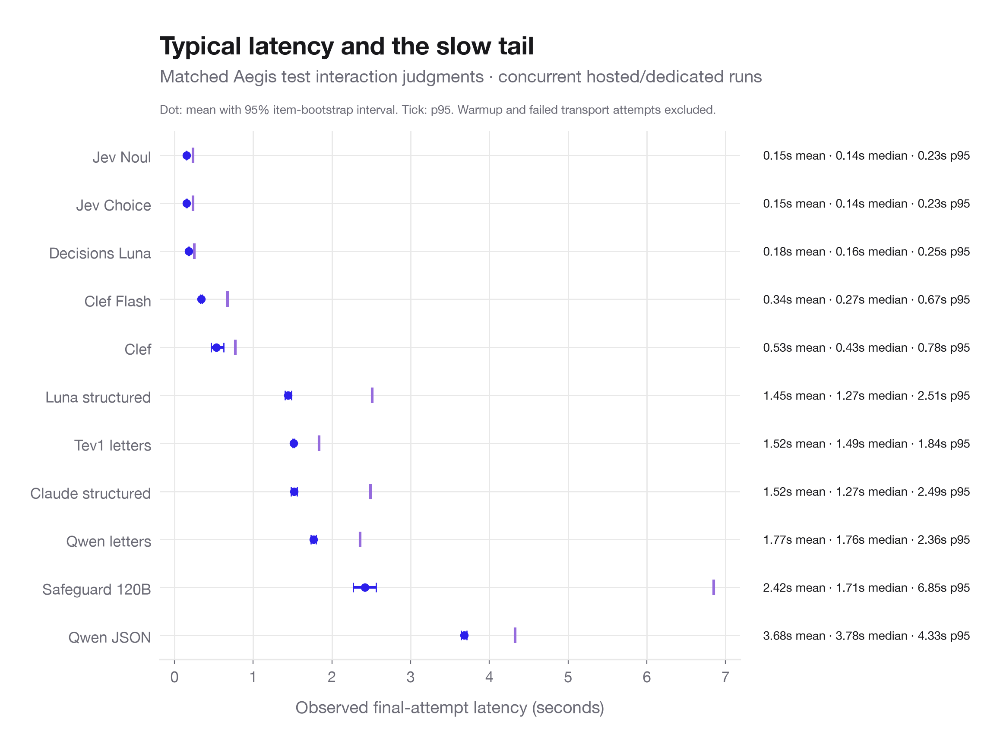
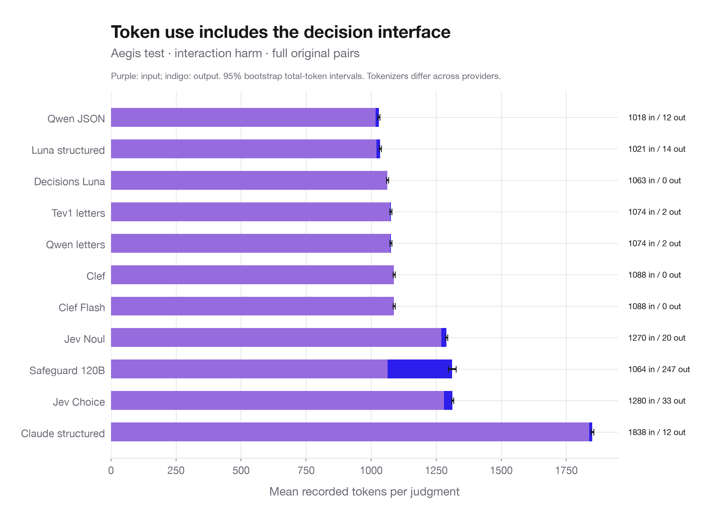
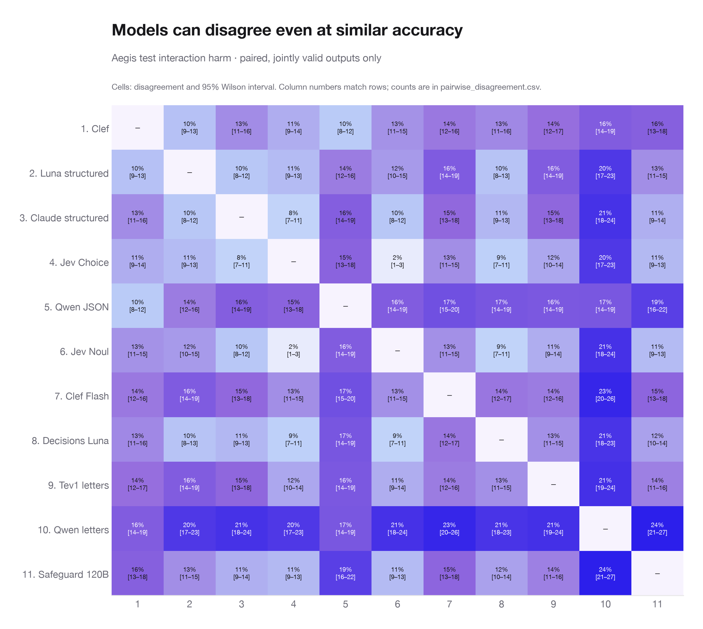
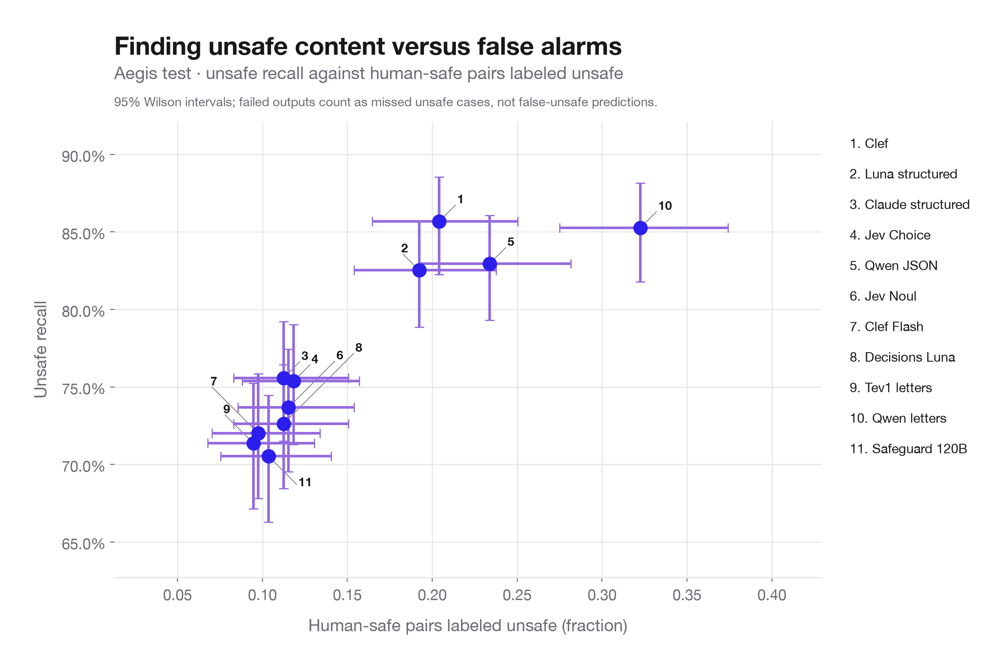
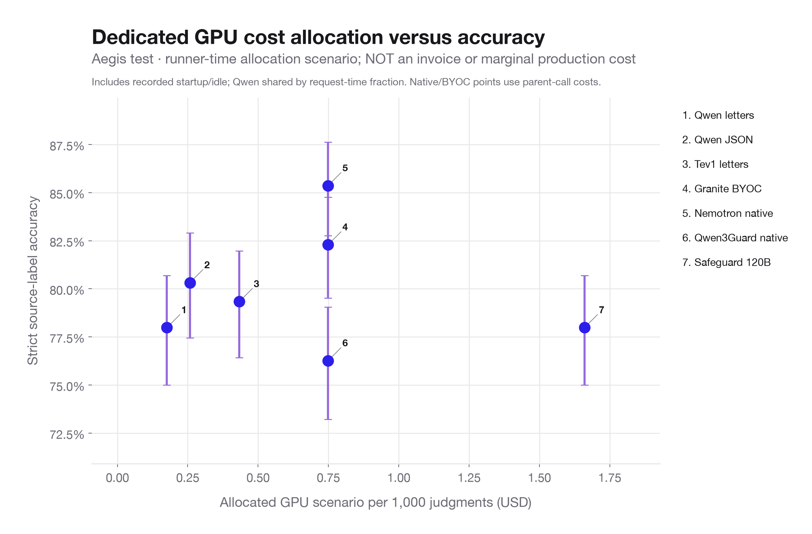
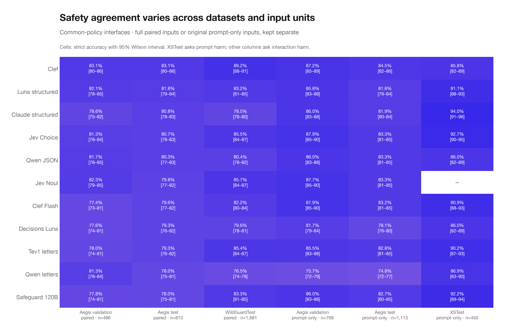

# Full source safety evaluations — descriptive report

All three source runs are verified complete: **124,773 physical predictions and 14,900 reused derived judgments**. Headline metric: `source_accuracy`, strict agreement with published human labels (or the explicitly declared either-turn OR). Model refusals, invalid outputs, and truncations count as incorrect. This is source-label agreement, not an independently adjudicated policy audit or a new held-out/preregistered result; prior development exposure remains disclosed.

## Matched safety comparison

Aegis test, original prompt-response pairs, interaction harm: **813 identical examples per common-policy interface**. Native/BYOC guards appear separately in the judgment and dedicated-cost views. These intervals describe item variability on this source, not training-run uncertainty; models are paired, so overlapping intervals are not a significance test.

| Model | Accuracy | 95% CI | Unsafe recall | Safe false alarm | Median seconds | Token $ / 1k | Mean in / out |
| --- | --- | --- | --- | --- | --- | --- | --- |
| Clef | 83.1% | 80.4%–85.6% | 85.7% | 20.4% | 0.43 | 0.261 | 1088 / 0 |
| Luna structured | 81.8% | 79.0%–84.3% | 82.5% | 19.2% | 1.27 | 0.122 | 1021 / 14 |
| Claude structured | 80.8% | 78.0%–83.4% | 75.6% | 11.2% | 1.27 | 3.795 | 1838 / 12 |
| Jev Choice | 80.7% | 77.8%–83.3% | 75.4% | 11.8% | 0.14 | 0.054 | 1280 / 33 |
| Qwen JSON | 80.3% | 77.4%–82.9% | 82.9% | 23.4% | 3.78 | GPU billing | 1018 / 12 |
| Jev Noul | 79.8% | 76.9%–82.4% | 73.7% | 11.5% | 0.14 | 0.053 | 1270 / 20 |
| Clef Flash | 79.6% | 76.7%–82.2% | 72.0% | 9.8% | 0.27 | 0.041 | 1088 / 0 |
| Decisions Luna | 79.3% | 76.4%–82.0% | 72.6% | 11.2% | 0.16 | 0.106 | 1063 / 0 |
| Tev1 letters | 79.3% | 76.4%–82.0% | 71.4% | 9.5% | 1.49 | GPU billing | 1074 / 2 |
| Qwen letters | 78.0% | 75.0%–80.7% | 85.3% | 32.2% | 1.76 | GPU billing | 1074 / 2 |
| Safeguard 120B | 78.0% | 75.0%–80.7% | 70.5% | 10.4% | 1.71 | GPU billing | 1064 / 247 |

## Charts

### Hosted cost versus accuracy

### Matched safety accuracy

### Judgment-type accuracy

### Latency and slow tails

### Input/output token use

### Pairwise model disagreement

### Unsafe recall versus false alarms

### Dedicated GPU allocation scenario

### Variation across datasets and input units

## Descriptive statistics and denominators

- `scorer_stats.csv`: every observed scorer for every model × dataset × input unit × target × scheme × rubric × policy mode × physical/derived configuration. Includes count, missing count, coverage, mean, sample standard deviation, min/max, p05/p25/median/p75/p95/p99, sum, and mean interval. Zero-coverage scorers remain blank, never zero-filled.
- `resource_stats.csv`: the same summaries for cost, latency, input/output/total/cache tokens, PolicyLM characters/windows, and GPU allocation proxy. Derived rows have no physical latency/tokens; their `parent_inference_time_s` and allocated path cost reuse parents. Do not add derived resource totals to physical-call totals.
- `quality_by_configuration.csv`: strict accuracy, unsafe recall, safe false-unsafe rate, refusal recall, and safe refusal false-positive rate with explicit class denominators and Wilson intervals.
- `pairwise_disagreement.csv`: paired label disagreement across model interfaces within each source/input/target. Denominator is jointly valid output pairs; failure rates are reported separately. Cross-policy comparisons are flagged.
- `operational_by_arm.csv`: physical requests only. Overall task mixes differ; this is an operational inventory, not a pooled quality ranking.
- `resource_stats_by_arm.csv`: full physical-call resource distributions per arm, across its actual workload mix.
- `scorer_stats_by_arm_target.csv`: aggregate scorer distributions per model/target/configuration across sources; use the fully stratified table for comparisons.
- `scorer_definitions.csv`: meaning, denominator, and direction for every configured scorer, including the inapplicable lookalike scorer.
- `judgments.csv.gz`: tidy, reproducible row-level scores, labels, model revisions, run IDs, resource observations, and source IDs. No raw prompts/responses or credentials are exported.

In `quality_by_configuration.csv`, unsafe recall uses ALL human-unsafe cases (failures count as misses), and `safe_false_unsafe_rate` uses all human-safe cases. Derived `refusal_recall` and `refusal_false_positive_rate` use human refusal/compliance labels. The original recorded scorer `unsafe_recall` excludes failed/caution predictions, and original `refusal_recall` excludes failed predictions, so their means can differ from the strict class rates. The original `safe_refusal_fp` means a human-safe REFUSING response labeled UNSAFE in the response-harm task; it is not false-positive refusal detection. Scorer definitions and non-missing denominators are explicit in CSV. Averaging unrelated scorer dimensions is not accuracy. The three `binary_correct_nc_*` variants use alternate caution treatment and exclude invalid predictions; native caution counts as wrong under strict source agreement. Probability metrics exist only where probabilities were actually returned. `lookalike_fp` has no eligible stratum in these final source runs and is exported as missing, not zero.

## Cost and measurement scope

Current-rate recorded hosted token estimate: **$39.59**. The unchanged October 9 rate snapshot gives **$40.08** on the same final predictions. These exclude subscriptions, gateway fees, unrecorded transport retries, regional/long-context premiums, and credits; they are estimates, not invoices. Public rates were rechecked October 12. Clef Flash is now published at $0.038/M input versus $0.09/M in the historical snapshot. [Cloudflare Clef Flash pricing](https://developers.cloudflare.com/workers-ai/models/clef-flash/). Other primary references: [TypeSafe](https://typesafe.ai/blog/introducing-system-one-models-and-jev), [Clef](https://developers.cloudflare.com/workers-ai/models/clef/), [OpenAI standard pricing](https://developers.openai.com/api/docs/pricing), [Decisions pricing](https://developers.openai.com/api/docs/guides/decisions#pricing-and-availability), [Claude](https://platform.claude.com/docs/en/models/sonnet-5-5/overview). The historical snapshot is preserved.

Dedicated Baseten models have recorded token counts but no per-token invoice in this export. GPU scenario totals use **157.77 recorded runner minutes** times the selected two-L4, one-L4, or one-H100 resources; total allocation scenario **$32.71**. This runtime proxy can include inactive replay time and omit startup outside the runner, so it is neither measured billed spend nor a strict bound. Shared Qwen resources are allocated by the two interfaces' cumulative recorded request latency; this is an explicit accounting choice, not measured GPU utilization. Costs per judgment depend on concurrency, throughput, idle time, and workload mix. Native OR and Nemotron component views reuse parent-call costs without additional inference. [Baseten resource pricing](https://www.baseten.co/pricing/). PolicyLM's local CPU/compute spend and token counts are unavailable; absent values are not free usage.

Latency is the recorded final-attempt request duration, from concurrent runs with restarts and network interruptions. API warmup and failed transport attempts are excluded from successful-final-attempt latency; this is not a controlled serving-speed benchmark. Percentile intervals in figures describe item variability. Continuous-score mean intervals in CSV use normal standard-error intervals; binary scorer intervals use Wilson. Tokenizers, adapter instructions, and wrappers differ across providers.

## Coverage and native-policy caveats

Aegis validation: 486 paired + 709 prompt-only; Aegis test: 813 paired + 1,113 prompt-only; WildGuardTest: 1,681 paired; XSTest: 450 prompt-only. Refusal evaluation excludes one WildGuard example without its source refusal label (n = 1,680). Aegis does not publish independent turn-harm labels; native turn views there stay unscored. WildGuard publishes both turn labels and refusal labels; either-turn harm is the study's declared OR. Native/BYOC rules and ternary caution may differ from common-policy instructions. PolicyLM is prompt-only and supplemental because of its published training/development-overlap caveat.

Recreate with `.venv/bin/python -m analysis.source_report`. All inputs are the audited final checkpoints; pilots and legacy runs are excluded.
